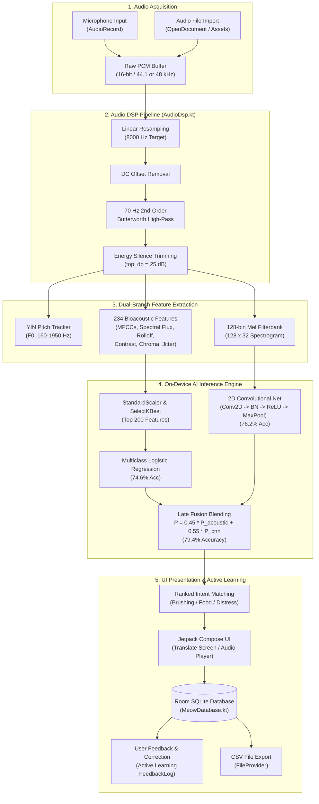

# Meow — Cat Voice Translator & Bioacoustic AI Analyzer

<div align="center">

[](https://github.com/MParsa9011/Meow/actions/workflows/ci.yml)
[](https://developer.android.com)
[](https://kotlinlang.org)
[](https://developer.android.com/jetpack/compose)
[](https://gradle.org)
[](https://developer.android.com/training/data-storage/room)
[](LICENSE)

**An on-device, real-time bioacoustic feline translator and health monitoring companion built with modern Android, Jetpack Compose, Material 3, and Kotlin.**

[Features](#key-features) • [Architecture](#system-architecture) • [Model Benchmarks](#model-performance--benchmarks) • [Quick Start](#getting-started) • [Tech Stack](#tech-stack) • [Roadmap](#roadmap)

</div>

---

## Overview

**Meow** translates feline vocalizations into human-interpretable behavioral intents directly on-device with zero server latency and full pet privacy. Powered by an on-device **Hybrid Late-Fusion AI engine** (`79.4% accuracy`), Meow combines traditional bioacoustic DSP feature extraction with a 2D Mel Spectrogram Convolutional Neural Network (CNN) to categorize meows into actionable feline emotional and physiological states.

---

## Key Features

- **On-Device Hybrid Late-Fusion AI Engine (`79.4%` Test Accuracy)**:
  - Fuses probabilities from a **234-feature bioacoustic pipeline** (`45% weight`) and a **128-bin Mel Spectrogram 2D CNN** (`55% weight`).
  - Zero external cloud latency — runs entirely on Android via optimized Kotlin tensor math with weights bundled in `app/src/main/assets/cat_ai_model.json` (`346 KB`).
  - Three distinct vocal intent classifications:
    - **Brushing (`B`)**: Affection, grooming, contented purrs, friendly greeting trills.
    - **Food (`F`)**: Meal requests, appetite alerts, rhythmic short meows.
    - **Isolation (`I`)**: Separation anxiety, distress calls, searching vocalizations.

- **Real-Time Audio DSP Pipeline**:
  - Linear audio resampling to target $8\,\text{kHz}$ sampling rate.
  - DC offset elimination and $70\,\text{Hz}$ 2nd-order bidirectional Butterworth high-pass filtering.
  - Top-$25\,\text{dB}$ energy-based silence trimming.
  - Real-time **YIN pitch tracking** extracting fundamental feline frequencies ($F_0$ in $160\text{--}1950\,\text{Hz}$).

- **Flexible Input Sources & Interactive Audio**:
  - Live recording using Android `AudioRecord` with floating waveform visualizer.
  - File picker integration (`OpenDocument`) to import external `.wav` recordings.
  - Preloaded feline acoustic benchmarks for instant offline demonstration (`Food Meow`, `Happy Trill`, `Distress Call`).
  - Synthesized cat purr / chirp playback for two-way human-to-cat communication.

- **Translation History & Active Learning**:
  - Persistent translation records saved in a local Room database with full acoustic metadata (pitch $F_0$, RMS energy, duration, top probabilities).
  - Search, bookmarking, and category filters (Time Horizon and Intent).
  - Single-click CSV export via secure Android `FileProvider`.
  - Active learning feedback loop (thumbs up/down and manual intent correction saved for personal calibration).

- **Multi-Pet Management & Analytics**:
  - Individual cat profiles with custom photo portraits via Android Photo Picker (`PickVisualMedia`).
  - Acoustic calibration baselines, weekly vocal trend charts, and veterinary notes.

- **Modern Internationalized UI**:
  - 100% Jetpack Compose with Material 3 design tokens and fluid animations.
  - System-wide Dark and Light mode support.
  - Bilingual localization: English and Persian (فارسی) with typography backed by *Plus Jakarta Sans* and *Vazirmatn*.

---

## System Architecture

The following diagram illustrates Meow's end-to-end audio acquisition, DSP pre-filtering, dual-branch feature extraction, late-fusion inference, and active learning persistence:



---

## Project Structure

```
Meow/
├── .github/
│   ├── ISSUE_TEMPLATE/
│   │   ├── bug_report.md            # Standard bug report template
│   │   └── feature_request.md       # Feature request proposal template
│   ├── workflows/
│   │   ├── ci.yml                   # CI: Gradle build & code quality checks
│   │   └── build-apk.yml            # CI: Standalone APK artifact packaging
│   └── PULL_REQUEST_TEMPLATE.md     # Pull request review checklist
├── app/
│   ├── build.gradle.kts             # App-level build config, SDK versions & dependencies
│   ├── proguard-rules.pro           # R8 / ProGuard optimization rules
│   └── src/main/
│       ├── AndroidManifest.xml      # App permissions, activities & FileProvider
│       ├── aidl/                    # In-App Billing AIDL definitions (Myket v3)
│       ├── assets/
│       │   ├── cat_ai_model.json    # Trained weights for Late Fusion CNN + Bioacoustic model
│       │   └── samples/             # Bundled WAV samples for offline testing
│       ├── java/com/example/
│       │   ├── MeowApplication.kt   # Application entrypoint & database bootstrap
│       │   ├── MainActivity.kt      # Main Activity, Jetpack Compose navigation host
│       │   ├── audio/
│       │   │   ├── AudioDsp.kt              # Resampling, Butterworth filter, YIN pitch & MFCC
│       │   │   ├── AudioRecorderManager.kt  # Thread-safe microphone recorder & audio player
│       │   │   └── CatAiInferenceEngine.kt  # On-device tensor math & late-fusion engine
│       │   ├── billing/
│       │   │   ├── MyketIabHelper.kt        # In-App Billing helper service
│       │   │   └── MyketSecurity.kt         # Cryptographic RSA purchase verification
│       │   ├── data/
│       │   │   ├── local/                   # Room DB, DAOs & SharedPreferences store
│       │   │   └── model/                   # Domain entities, intents & app settings
│       │   └── ui/
│       │       ├── MainViewModel.kt         # MVVM ViewModel coordinating state & audio
│       │       ├── components/              # Top/bottom bars, waveform graphs, toasts
│       │       ├── modals/                  # Pet profile, subscription & explanation sheets
│       │       ├── screens/                 # Translate, History, Profile, Settings screens
│       │       └── theme/                   # Material 3 colors, typography & strings
│       └── res/                             # Vector drawables, fonts, layouts & localized strings
├── gradle/
│   └── libs.versions.toml           # Version Catalog for AGP, Kotlin, Compose & Room
├── public/assets/aistudio/          # UI mockups, brand assets & visual previews
├── .env.example                     # Environment secrets template
├── .gitignore                       # Production-grade gitignore configuration
├── build.gradle.kts                 # Root Gradle build configuration
├── CHANGELOG.md                     # Semantic version changelog
├── CONTRIBUTING.md                  # Contributor workflow and coding guidelines
├── LICENSE                          # MIT License
├── metadata.json                    # Project metadata & runtime requirements
├── README.md                        # Project documentation (this file)
└── settings.gradle.kts              # Gradle plugin & repository management
```

---

## Model Performance & Benchmarks

The inference engine runs locally without any cloud dependencies. Metrics are validated across the annotated feline vocalization dataset:

| Model Architecture | Test Accuracy | Model Size | Input Representation | On-Device Latency (ARM64) | Primary Features |
| :--- | :---: | :---: | :---: | :---: | :--- |
| **Hybrid Late Fusion (Active)** | **79.4%** | **346 KB** | Dual (Waveform + Spectrogram) | **~35–55 ms** | Weighted blend ($0.45 \times \text{Acoustic} + 0.55 \times \text{CNN}$) |
| **Spectrogram 2D CNN** | 76.2% | ~100 KB | $128 \times 32$ Mel Spectrogram | ~25–40 ms | 2-stage Conv2D + BatchNorm + MaxPool |
| **Enhanced Bioacoustic Pipeline** | 74.6% | ~246 KB | 234 Extracted Scalars | ~15–25 ms | YIN Pitch, 20 MFCCs, Spectral Flux, Rolloff |

### Classification Categories

| Intent Class | Code | Primary Acoustic Signature | Human Translation Equivalent |
| :--- | :---: | :--- | :--- |
| **Brushing** | `B` | Low-to-moderate $F_0$ ($300\text{--}650\,\text{Hz}$), stable harmonics, purr modulation | Affection, tactile bonding, friendly greeting |
| **Food** | `F` | High rhythmic pitch contour ($500\text{--}950\,\text{Hz}$), short repetitive bursts | Hunger, feeding request, snack demand |
| **Isolation** | `I` | Extended duration, wide pitch excursion ($600\text{--}1800\,\text{Hz}$), high energy | Distress call, separation anxiety, searching |

---

## Tech Stack

- **Application & Framework**: Android 8.0+ (API 26–36), Android Gradle Plugin 9.1.1, Gradle 9.3.1.
- **Language**: Kotlin 2.2.10 (Kotlin Coroutines, StateFlow).
- **UI & Design**: Jetpack Compose (BOM 2024.09.00), Material 3, Coil Compose 2.7.0.
- **Bioacoustics & DSP**: Custom on-device Digital Signal Processing (linear resampler, YIN pitch detection, FFT, Butterworth high-pass filter, 128-bin Mel filterbank).
- **Machine Learning**: Custom Kotlin inference engine (SelectKBest, StandardScaler, Logistic Regression, 2D CNN with BatchNorm and ReLU).
- **Data Persistence**: Room 2.7.0 with Kotlin Symbol Processing (KSP 2.3.5), Android `FileProvider`.
- **Billing & Security**: Myket In-App Billing v3 (AIDL), RSA-SHA1 signature verification, Secrets Gradle Plugin 2.0.1.

---

## Getting Started

### Prerequisites

- **Java Development Kit (JDK)**: JDK 21
- **Android Studio**: Android Studio Ladybug (2024.2+) or newer
- **Android SDK**: Android SDK 36 (target), Android SDK 26 (minimum)

### Installation & Build

1. **Clone the repository**:
   ```bash
   git clone https://github.com/MParsa9011/Meow.git
   cd Meow
   ```

2. **Set up environment configuration**:
   ```bash
   cp .env.example .env
   ```
   *(The placeholder in `.env.example` is sufficient for debug builds and testing).*

3. **Generate a local debug keystore** (if building via CLI):
   ```bash
   keytool -genkey -v -keystore debug.keystore \
     -storepass android -alias androiddebugkey -keypass android \
     -keyalg RSA -keysize 2048 -validity 10000 \
     -dname "CN=Android Debug,O=Android,C=US"
   ```

4. **Build the Debug APK**:
   ```bash
   gradle assembleDebug
   ```

5. **Install on connected device or emulator**:
   ```bash
   adb install -r app/build/outputs/apk/debug/app-debug.apk
   ```

---

## Roadmap

- [x] On-device Hybrid Late Fusion AI inference engine (`79.4%` accuracy).
- [x] Audio DSP pre-filtering (resampling, DC offset, Butterworth filter, YIN pitch).
- [x] Live recording, external audio file upload, and bundled feline sample playback.
- [x] Translation history, search, bookmarks, and CSV report export.
- [x] Multi-cat profiles with avatar photo picker and weekly vocal analytics.
- [x] Bilingual localization (English / Persian) with dynamic typography.
- [x] In-app billing (IAB v3) with cryptographic RSA verification.
- [ ] Export inference models to standard ONNX and TensorFlow Lite formats.
- [ ] Continuous passive listening mode with low-power wake-meow activation.
- [ ] Wear OS companion tile for wrist-based feline alerts.
- [ ] Individual cat voice calibration and active learning personalization.

---

## Contributing

Contributions make open-source projects thrive! Please read our [CONTRIBUTING.md](CONTRIBUTING.md) for full instructions on our coding standards, branch conventions, and pull request process.

---

## License

This project is licensed under the **MIT License**. See the [LICENSE](LICENSE) file for complete details.

Copyright © 2026 **Mohammad Parsa Salehi**.
